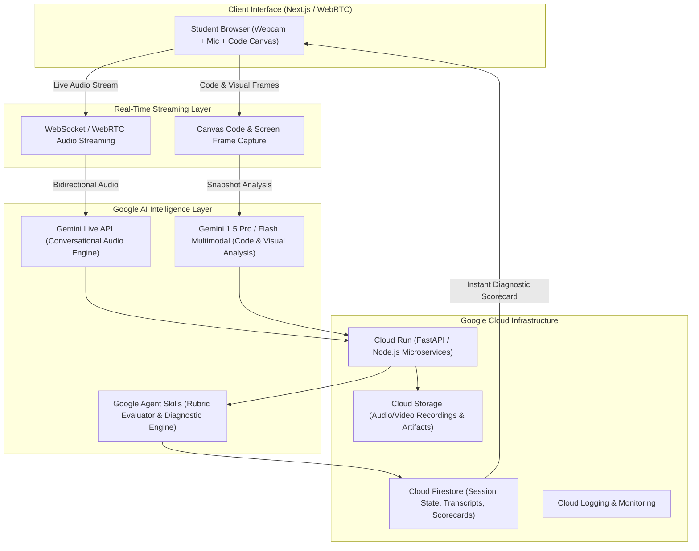

# PlacementPilot AI — Google AI & Cloud Buildathon Application Package

**Project Name:** PlacementPilot AI (or MockLive AI)  
**One-Line Pitch:** A real-time, multimodal AI mock interviewer that gives tier-2/3 college graduates personalized technical and HR interview practice using Gemini Live and Google Cloud.

---

## 1. Application Submission Answers (Copy & Paste Ready)

### 01. Founder Profile & "Why Us"
* **Who we are:** We are a team of passionate engineers and recent graduates who personally experienced the intense anxiety and preparation gap during campus placements in Tier-2/3 engineering colleges.
* **Why we built this:** Over 1.5 million engineering graduates enter the job market in India annually. Despite having technical potential, over 80% stumble in initial technical and HR rounds due to lack of mock interview exposure, communication anxiety, and zero access to personalized feedback. With Google's breakthroughs in **Gemini Live (real-time low-latency audio)** and **multimodal vision**, we can finally democratize 1-on-1 premium interview coaching for every student at 1/100th of the cost.

---

### 02. Problem Potential & Value Proposition
* **The Problem:** 
  College Training & Placement (T&P) cells have a student-to-counselor ratio of 500:1. It is mathematically impossible for placement officers or human mentors to conduct 3–5 mock interviews for every graduating student. Current preparation alternatives are either:
  1. *Static Question Banks (LeetCode/GeeksforGeeks):* Great for coding, but zero practice for verbal explanation, stress-handling, or behavioral HR questions.
  2. *Human Coaching Services:* Prohibitively expensive (₹3,000–₹10,000 per session), completely out of reach for average college students.
  3. *Generic Text Chatbots (ChatGPT wrappers):* Text-based typing does not simulate real-time conversational pressure, spoken fluency, or live whiteboard coding.
* **The Solution:** 
  **PlacementPilot AI** is an autonomous, multimodal interview simulator:
  * **Spoken Conversational Dialogue:** Powered by Gemini Live for zero-latency, realistic voice back-and-forth. The AI interrupts, asks clarifying follow-ups, and adapts difficulty dynamically based on candidate answers.
  * **Multimodal Code & Whiteboard Evaluation:** Students can write code or draw system architecture on screen; Gemini Vision analyzes the code structure and logic in real time.
  * **Actionable Diagnostic Scorecard:** After each 15-minute mock session, students receive an instant diagnostic report breaking down Conceptual Accuracy (0–100), Communication Clarity, Filler Word Frequency, and an actionable improvement roadmap.

---

### 03. Market Viability & Go-To-Market (GTM)
* **Target Addressable Market (TAM):** 
  * **India Higher Ed & Job Seekers:** ~35 Million undergraduate students across engineering, commerce, and management; 1.5M+ engineers graduating yearly.
  * **Global Tech Interview Prep Market:** Projected to reach \$7.8 Billion by 2028.
* **Serviceable Obtainable Market (SOM):** 
  * 3,500+ engineering colleges in India with formal T&P cell budgets, targeting 250,000 students in the first 18 months.
* **Business Model (Dual B2C + B2B):**
  1. **B2C Freemium:** 1 Free Diagnostic Mock Interview; Unlimited Mock Interviews + In-Depth Video Analysis at ₹399/month during campus placement season (August–December).
  2. **B2B SaaS for Colleges (Primary revenue engine):** Annual subscription sold to College Placement Offices at ₹500–₹800/student/year, providing an administrative dashboard to track student readiness and identify batch-wide skill gaps.
* **Go-To-Market Strategy:**
  * **Campus Ambassador Network:** Partner with student placement coordinators across 50 tier-2/3 campuses in Bangalore, Pune, Hyderabad, and Chennai.
  * **Placement Cell Pilot Programs:** Offer 10 colleges a free 30-day trial for their pre-final year batch to generate placement success case studies.

---

### 04. Technical Architecture (Built on Google Cloud & Google AI)

* **Frontend:** Next.js 14, Tailwind CSS, Monaco Editor (code canvas), Web Audio API / MediaRecorder.
* **AI Engine:**
  * **Gemini Live API:** Handles continuous, bidirectional streaming audio with low-latency turn-taking.
  * **Gemini 1.5 Pro / Flash:** Evaluates submitted code complexity, edge cases, and algorithmic correctness.
  * **Google Agent Skills:** Orchestrates interview phases (Greeting &rarr; Technical Core &rarr; Edge Cases &rarr; Behavioral HR &rarr; Feedback Synthesis).
* **Backend & Cloud:**
  * **Google Cloud Run:** Fully managed, autoscaling containerized microservices.
  * **Google Cloud Firestore:** Real-time persistence for candidate responses, rubrics, and diagnostic analytics.
  * **Google Cloud Storage:** Secure, temporary storage for audio snippets and code snapshots.

---

### 05. Deep Use of Google AI
* **Gemini Live:** Enables conversational latency under 500ms, making the interview feel like a real human recruiter rather than an awkward robotic form.
* **Multimodal Reasoning:** Reads code written on screen without requiring copy-pasting, simulating realistic technical whiteboard interviews.
* **Google Antigravity & Agent Skills:** Powers the scoring agent that evaluates candidate responses against standardized industry rubrics (FAANG / Big 4 / Indian IT Services standards) while eliminating subjective bias.

---

## 2. 5-Slide Pitch Deck Structure (For Online Submission & Regional Showcase)

### Slide 1: Cover & Vision
* **Headline:** PlacementPilot AI
* **Sub-headline:** The Multimodal AI Interview Coach for Bharat's 1.5 Million Graduates.
* **Presenter:** [Your Name / Team Name], [City / College]
* **Key Visual:** Split screen showing a student speaking on webcam and Gemini Live responding with real-time audio waveforms and code highlighting.

### Slide 2: The Urgent Problem
* **Fact:** 80%+ of graduates from 3,500+ tier-2/3 engineering colleges fail campus interviews due to zero interview exposure.
* **Root Cause:** T&P cells have a 1:500 mentor-to-student ratio. Students practice coding on LeetCode in silence, but freeze when asked to explain their logic verbally to an interviewer.
* **The Cost:** Hundreds of thousands of unfilled entry-level positions and disappointed graduates.

### Slide 3: The Solution — PlacementPilot AI
* **Three Core Pillars:**
  1. **Spoken, Conversational Mock Interviews:** Powered by Gemini Live — natural interruption, adaptive follow-ups, and pressure-testing.
  2. **Multimodal Whiteboarding & Coding:** Reads live code, checks logic, and tests edge-case reasoning.
  3. **Instant 360° Diagnostic Report:** Scores technical depth, communication clarity, problem-solving speed, and provides a customized 7-day remediation plan.

### Slide 4: Technology & Google AI Advantage
* **Why Google AI Stack:**
  * Ultra-low latency voice with Gemini Live.
  * Multimodal visual context with Gemini Vision.
  * Scalable, enterprise-ready deployment on Google Cloud Run & Firestore.
* **Defensibility:** Proprietary database of 10,000+ Indian campus placement questions mapped to corporate hiring rubrics + continuous fine-tuning on regional communication patterns.

### Slide 5: Business Model & Go-To-Market
* **Dual Revenue Model:**
  * **B2B:** Annual college T&P subscription: ₹600/student/year (~₹6-10 Lakhs per college).
  * **B2C:** Direct student subscription: ₹399/month during peak placement season.
* **Target Traction (Year 1):** 30 Partner Colleges, 45,000 active students, ₹2.5 Crore ARR.
* **Roadmap for 2-Day City Buildathon (20–21 Nov):** Deliver a working 5-minute live technical interview with automated code review and instant scorecard generation.

---

## 3. 48-Hour City Buildathon Blueprint (20–21 November)

| Timeframe | Milestone | Deliverable |
| :--- | :--- | :--- |
| **Day 1: Morning** | Architecture Setup | Setup Google AI Studio API keys, Next.js frontend shell, and Cloud Run backend template. |
| **Day 1: Afternoon** | Gemini Live Integration | Implement bidirectional audio streaming over WebSocket with speech turn-taking. |
| **Day 1: Evening** | Code Canvas & Prompt Engineering | Embed Monaco Editor / code canvas; build the Gemini system prompt with interview rubrics. |
| **Day 2: Morning** | Scorecard & Diagnostic Agent | Implement post-interview summary agent generating JSON scores (accuracy, fluency, advice). |
| **Day 2: Afternoon** | End-to-End Polish & Cloud Run Deploy | Deploy container to Google Cloud Run, test live 3-minute demo, and refine presentation slides. |
| **Day 2: Evening** | Jury Showcase | Deliver live demo on stage: Voice interview + live coding + instant scorecard generation. |
