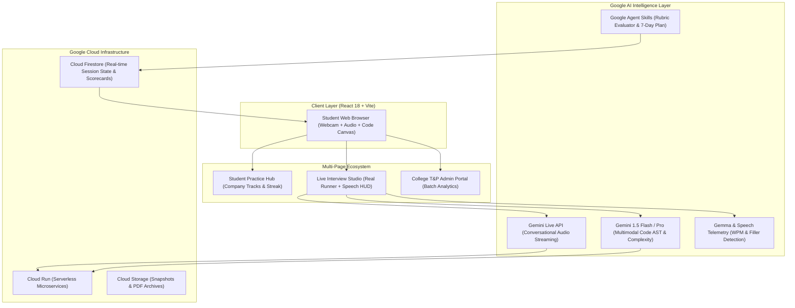

# PlacementPilot AI 🎯

> **A Real-Time Multimodal AI Mock Interview Coach & Employability Platform**  
> Built for the **Google AI & Cloud Buildathon 2026** by **Shagun Mehta**.

[](https://aistudio.google.com/)
[](https://react.dev/)
[](https://tailwindcss.com/)
[](LICENSE)

---

## 📑 Quick Links
* 📄 **[Official Pitch Deck (PDF)](./PlacementPilot_Pitch_Deck.pdf)** — 8-Slide Investor Presentation
* 🌐 **[Interactive Web Deck (HTML)](./PlacementPilot_Pitch_Deck.html)** — Viewable in any browser
* 📝 **[Full Application Package (Markdown)](./PlacementPilot_Application_Package.md)** — Complete Hackathon submission answers & founder profile

---

## 🌟 The Problem & Vision
Over **80% of graduates from Tier-2 and Tier-3 engineering colleges fail initial campus technical and HR rounds**. While students practice syntax on LeetCode in complete silence, they freeze when asked to explain architectural trade-offs orally under scrutiny. Meanwhile, College Training & Placement (T&P) cells face an impossible **500:1 student-to-counselor ratio**.

**PlacementPilot AI** solves this with an autonomous, multimodal platform powered by **Google Gemini Live**, **Gemini Multimodal Vision**, and **Google Cloud Run**:
1. Replaces silent typing with **real-time spoken voice interviews (<500ms latency)**.
2. Ingests candidate code on a live canvas to test **algorithmic logic and time/space complexity**.
3. Empowers colleges with an **Institutional T&P Admin Portal** for batch-wide NIRF/NAAC employability analytics.

---

## 🏛️ System Architecture



---

## 🚀 Key Modules & Features

### 1. 📊 Student Practice Hub (`StudentHub.jsx`)
* **Personalized Dashboard:** Welcome banner for **Shagun Mehta** showing readiness score (**82%**), 4-day practice streak, and completed sessions.
* **Curated Company Hiring Tracks:**
  * **TCS / Infosys / Wipro:** Core Data Structures, Arrays, Strings, OOPs, DBMS.
  * **Amazon / Tier-1 Big Tech:** Sliding Window, Dynamic Programming, System Design, STAR Behavioral.
  * **High-Growth FinTech Startup:** Concurrency, Rate Limiting, Caching, Token Bucket.
* **Active 7-Day Remediation Roadmap:** Targeted daily assignments based on past mock deficiencies.

### 2. 💻 Live Interview Studio (`CodeCanvas.jsx` & `VideoFeed.jsx`)
* **Real In-Browser Code Execution:** An isolated client sandbox executing code against real test cases with millisecond runtime tracking and console log capture.
* **Dynamic AI Problem Generator:** Calls Gemini to generate novel interview problems on demand across custom topics and difficulty levels.
* **Google Meet-Style Video HUD:** Real-time webcam feed, animated recruiter tile, and live speech telemetry (Words Per Minute + Filler Word counter).
* **Socratic Dialogue Engine:** Gemini interrupts rambling, asks for Big-O complexity, and probes edge-case handling.

### 3. 🏢 College Placement Cell Admin Portal (`OfficerDashboard.jsx`)
* **Institutional Employability Tracking:** Aggregated readiness metrics for **1,420 graduating students** (78.4% campus hiring readiness).
* **Batch-Wide Skill Gap Diagnostics:** Identifies critical batch vulnerabilities (e.g., Spoken Communication at 62% vs DSA at 84%).
* **Searchable Student Cohort Table:** Live filtering by department (CSE, IT, ECE) with student placement status flags.
* **NAAC/NIRF Accreditation Report:** 1-click printable PDF generation for institutional audits.

### 4. 🎨 Design System & Authentication
* **1-Click Theme Switcher:** Seamless toggle between **Light Mode** (clean white/gray) and **Dark Mode** (deep slate).
* **Role-Based Authentication:** Toggle between Student Aspirant mode and College Placement Cell mode.

---

## 💼 Business Model & Unit Economics
* **B2B Institutional SaaS (Primary Revenue):** Sold directly to College Placement Offices at **₹500–₹800 per student/year** (₹5–10 Lakhs/campus/year).
* **B2C Freemium (Viral Bottom-Up):** 1 Free diagnostic mock interview; **₹399/month** for unlimited mock interviews during placement season.
* **Unit Economics:** Cloud Run serverless compute + Gemini API batching cost **≈ ₹18 per 15-minute mock interview**, delivering **85%+ gross margins**.

---

## 🛠️ Local Installation & Development

```bash
# 1. Clone your repository
git clone https://github.com/shagun12mehta-maker/placement-pilot-ai.git
cd placement-pilot-ai

# 2. Install dependencies
npm install

# 3. Start local development server
npm run dev
```

Visit: `http://localhost:3000`

---

## 📅 Roadmap for City Buildathon (20–21 November)
* [x] **Day 1 (Scaffolding):** Multi-page platform, real code runner, and Gemini prompt orchestration.
* [x] **Day 1 (UI/UX):** Google Meet call interface, LeetCode editor, and Light/Dark themes.
* [ ] **Day 2 (Cloud Deployment):** Deploy containerized microservice to **Google Cloud Run**.
* [ ] **Day 2 (Persistence):** Connect **Cloud Firestore** for cross-device student score history.
* [ ] **Grand Finale (Bengaluru):** Live on-stage mock interview demo with jury scoring.

---

## 👤 Founder
**Shagun Mehta**  
*Student Founder & Lead Developer*  
Email: [shagun12mehta@gmail.com](mailto:shagun12mehta@gmail.com)  
GitHub: [@shagun12mehta-maker](https://github.com/shagun12mehta-maker)
